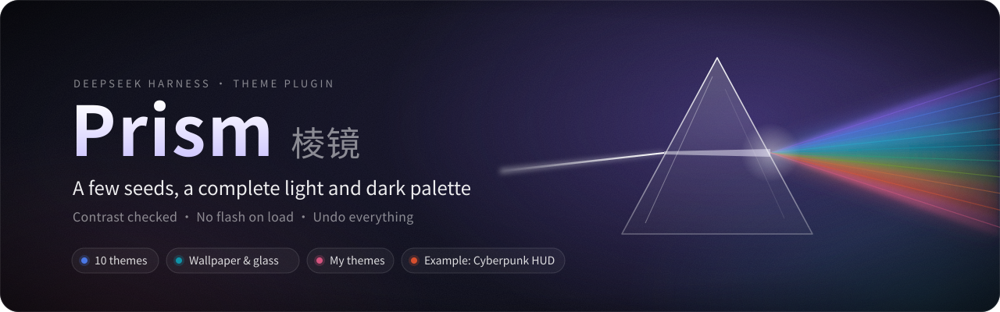
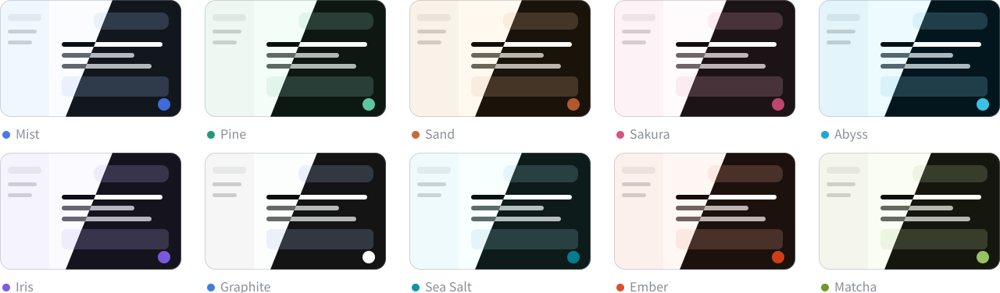
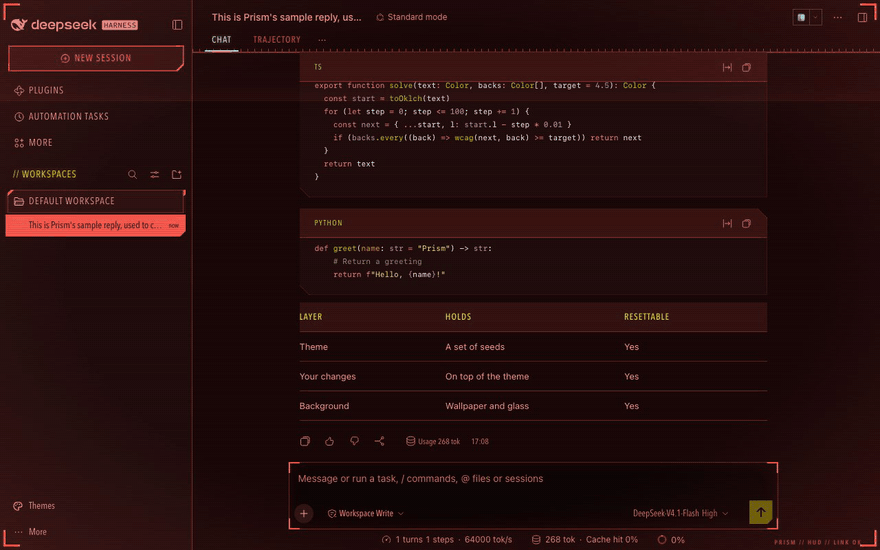
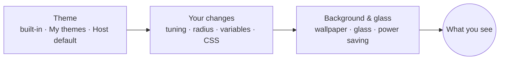

<p align="center">
  
</p>

<p align="center">
  <a href="https://github.com/Wildchiken/dsh-prism-skin/releases/latest"></a>
  
  
  <a href="LICENSE"></a>
</p>

<p align="center"><a href="README.md">中文</a> · <b>English</b></p>

Themes for DeepSeek Harness (DSH). Pick a theme, or drag a few sliders (hue, chroma, neutral tint, contrast, depth, accent), and Prism recomputes every host color variable as a light and dark pair, with every text/background pair checked for contrast.

<p align="center">
  
</p>
<p align="center"><sub>The ten built-in themes: light in the top-left half of each card, dark in the bottom-right. The colors are computed by the engine, not screenshots.</sub></p>

## Example: Cyberpunk HUD

A theme file can carry more than colors: variable overrides and custom CSS too. This Cyberpunk HUD is a single theme file you import:

<p align="center">
  
</p>

- **Look**: red on near-black, cyan headings, yellow accents; the sidebar, buttons, code blocks and messages become cut-corner frames, with corner brackets on the window and faint scanlines.
- **Motion**: a slow scan line, a light glitch on hover, a flicker on selection. Everything stops when the system's Reduce motion is on.
- **Install**: download [`cyberpunk-hud.json`](https://github.com/Wildchiken/dsh-prism-skin/releases/latest/download/cyberpunk-hud.json), then in **Settings → Prism → Import & export** click "Choose file…" and "Apply". It lands in My themes under its name, one click away from then on.

> [!NOTE]
> The frames come from custom CSS that targets the host's internal class names, so a DSH update may break some of them (the colors are unaffected); an updated file fixes that. Dark only. The style is a nod to the cyberpunk genre and is not affiliated with any game or company.

## Install

Requires DSH 0.2.1-rc.5 or later, below 0.3. Tested on 0.2.1-rc.5 (web) and 0.2.2-rc.1 (web and macOS desktop).

**CLI / web**

```bash
dsh plugin --profile <name> add https://github.com/Wildchiken/dsh-prism-skin/releases/latest/download/dsh-prism-skin.tgz
```

**macOS desktop**: quit DeepSeek Harness completely with ⌘Q, install into the `desktop` profile with the app's bundled CLI, then reopen it.

```bash
cd ~ && "/Applications/DeepSeek Harness.app/Contents/Resources/runtime/cli/bin/dsh" plugin --profile desktop add https://github.com/Wildchiken/dsh-prism-skin/releases/latest/download/dsh-prism-skin.tgz
```

These links always point to the latest release. To pin a version use `https://github.com/Wildchiken/dsh-prism-skin/releases/download/v<version>/dsh-prism-skin-<version>.tgz` (see [Releases](https://github.com/Wildchiken/dsh-prism-skin/releases)). Not on npm yet.

## Use

- **Themes** at the bottom of the sidebar: switch theme, toggle light/dark, randomize, undo. It shows the current theme name and marks it Modified when you have changed it.
- **Settings → Prism**: the top row shows the current theme with three buttons, Discard changes, Save as my theme and Restore defaults. Below: the theme gallery, accent, background and glass, power saving, fonts, code colors, tuning and radius, advanced overrides, import & export, and the contrast check.

A theme and your changes on top of it are two separate layers:



- **Switching themes swaps the whole bundle**: you get the theme exactly as it ships and your previous changes are cleared (contrast and depth, being personal preferences, are kept).
- **To keep your changes**, click Save as my theme and give it a name. My themes holds up to 24; hover a card to delete it from the top-right corner (two clicks).
- **To go back to the host as it ships**, click Restore defaults: theme, changes and background are all cleared.
- **Every step is undoable**; hover to preview, click to apply.

## Features

**Colors**
- A theme covers all 224 host color variables (including markdown, diff and code highlighting), light and dark. Changing the accent recomputes buttons, links, bubbles, selection and code highlighting together.
- Every theme checks 258 text/background pairs against both WCAG and APCA and adjusts only lightness until they pass. Hovered text is held to 4.5:1 too.
- Code colors can be set separately: GitHub, One, Solarized, Dracula, Monokai, Nord, with the same contrast guarantees.

**Background**
- Images (pick a file, drop it in, or paste a link), gradients, solid colors, link rotation and folder rotation; one Glass slider controls every surface.
- Images are blurred once; no live `backdrop-filter`. Text contrast is computed against the darkest and brightest parts of the wallpaper, and transparency drops automatically when needed. Pick colors from the wallpaper in one click.
- Power saving: follow system / on / off. It kicks in with the system's Reduce transparency, or below 20% battery when not charging, replacing surfaces with solid colors derived from the wallpaper.

**Customization**
- Fonts and sizes (the same setting as General → Fonts) and a corner-radius multiplier.
- Search every host variable by name and edit it, seeing its current value and which layer it comes from.
- Custom CSS: up to 8192 characters; `@import` and external `url()` are blocked.

**Import & export**
- A theme file is a small JSON: the color seed, optionally with variable overrides, custom CSS and radius. Importing one adds it to My themes.
- Share codes are short enough to put in a link.
- One-click migration from dream-skin, dream-skin pack import, and export as a Skin Center skin (zip).

**Light and fast**
- No flash on load: your saved palette applies before the first paint.
- About 21 KB loads at startup; the color engine and settings UI (about 97 KB) load the first time you open settings or the quick panel; wallpaper processing (about 5 KB) and the advanced / import-export panels (about 32 KB) only when needed. No live blur, no page-wide DOM observers.

<details>
<summary><b>More screenshots</b></summary>

| Settings → Prism | Sidebar quick panel |
|---|---|
|  |  |

| Image wallpaper · dark | Gradient wallpaper · light |
|---|---|
|  |  |

| Dracula code colors · dark | Advanced: variable search |
|---|---|
|  |  |

Light and dark screenshots of all ten themes are in [docs/screenshots/](docs/screenshots/). They were recorded in a throwaway environment with a sample conversation.

</details>

## Using it with other theme plugins

Prism itself uses no `!important` and no hashed host class names; it changes color variables only through the host's official theme API (`overrideTokens`). (Custom CSS you write or a theme file brings, such as the Cyberpunk HUD above, is the exception.)

Another theme plugin that overrides those variables with its own styles will hide part of Prism's palette, so run one theme plugin at a time. Prism recognizes a few common ones (currently skin-center and claude-style) and only says so on the settings page and quick panel instead of fighting them.

Settings live in `$DSH_HOME/dsh-prism-skin/state.json` (by default `~/.dsh/dsh-prism-skin/state.json`, mode 0600), and wallpapers in `wallpapers/` next to it. The browser's localStorage is only a cache; open tabs stay in sync.

<details>
<summary><b>Known limitations</b></summary>

- **About 30% of corner radii are out of reach**: about 70% of the host's radii use `--dsw-radius-*` variables and follow the Radius slider; the rest (mostly 1–4px details) are hard-coded in host styles. Prism does not patch them through hashed class names.
- **Share between desktop apps with the share code**: a share link carries the current address, and the desktop app picks a new port on every launch, so the link will not open on another machine. Copy the share code and paste it into the other person's Import box.
- **Font changes are not undoable**: fonts and sizes are the host's General settings, outside Prism's undo history; fonts that come with an imported theme file cannot be undone either (the preview says so before you import).
- **My themes cannot be renamed directly yet**: save under the new name with Save as my theme, then delete the old one. Deleting cannot be undone.
- **Not yet tested on the desktop app**: GPU use in a real window, automatic power saving on low battery (the battery API was only tested with a simulated battery), and the system file picker for local wallpaper images.
- **The quick panel cannot jump to settings**: the host has no API for a sidebar plugin to open settings at a given section, so the panel footer is a note.
- **dream-skin migration is not pixel-identical**: themes are converted to seeds from their base, accent and scheme, and the remaining colors are recomputed with contrast guarantees. Lighter dark bases (such as Nord) come out a little darker.
- **The wallpaper folder is not cleaned up**: images you switch away from stay in `wallpapers/`.
- Safari and Firefox have no battery API, so Follow system only looks at Reduce transparency there.

</details>

<details>
<summary><b>Development</b></summary>

```bash
npm install
npm test                       # unit tests, including size gates and the contrast audit
npm run build                  # output in lib/
npm run audit:contrast         # contrast audit per theme and per code scheme
node scripts/readme-art.mjs    # redraw the README banner and theme overview
```

Smoke tests and screenshots on a real host need a locally installed host (`npm install @deepseek-ai/dsh@<version>`):

```bash
node scripts/smoke.mjs --host <host dir> [--host <another version>]
node scripts/shots.mjs --host <host dir> --extras --wallpapers --p3
```

Both scripts use a throwaway `~/.dsh-prism-*` as `DSH_HOME` and delete it afterwards; your own `~/.dsh` is never touched. See [CHANGELOG.md](CHANGELOG.md) for changes.

</details>

## Credits and license

The palette approach draws on dsh-dream-skin; see [NOTICE](NOTICE). Released under the [MIT](LICENSE) license.
