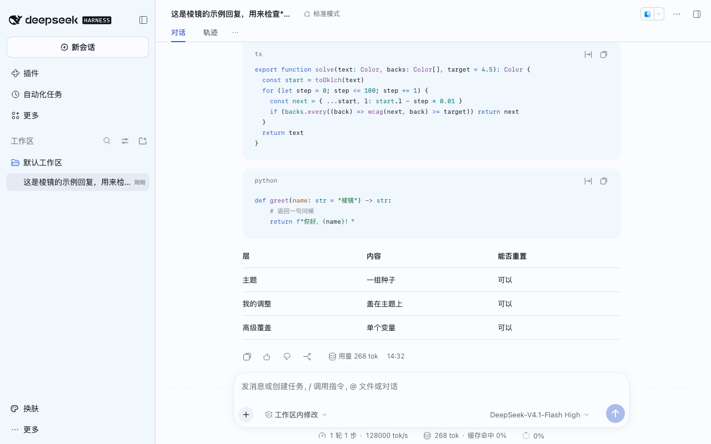
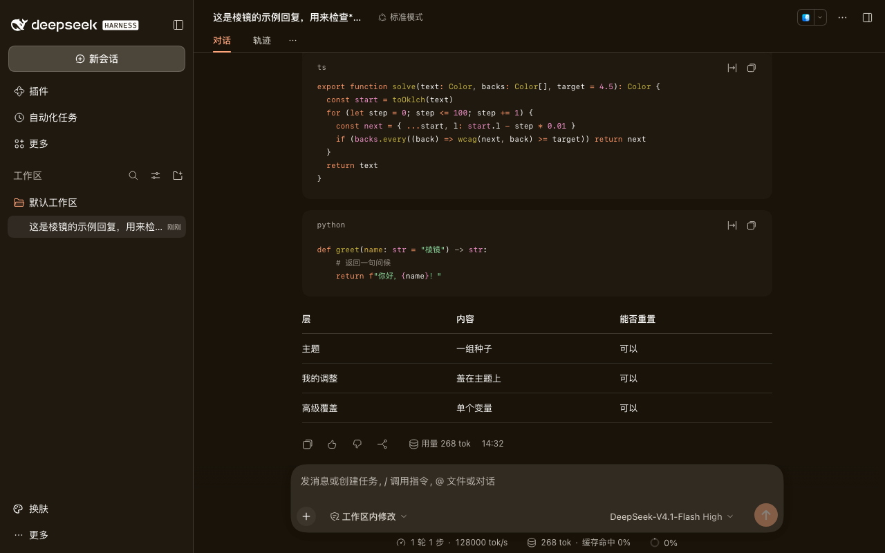
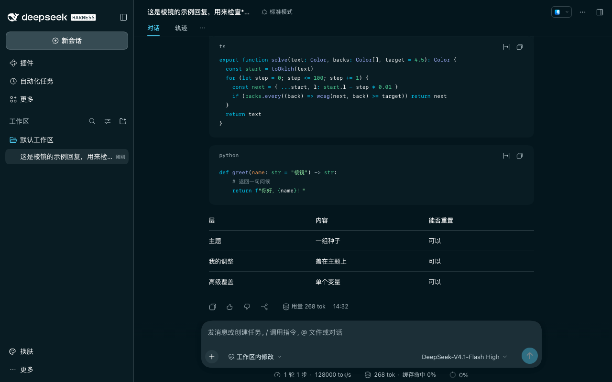
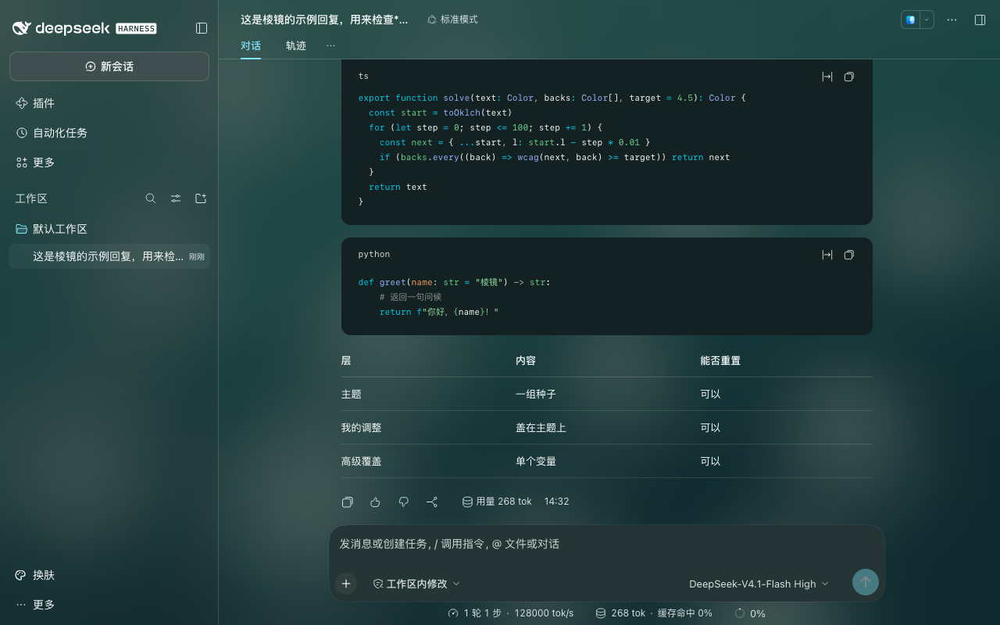
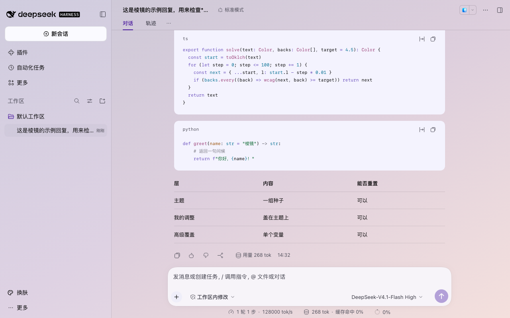
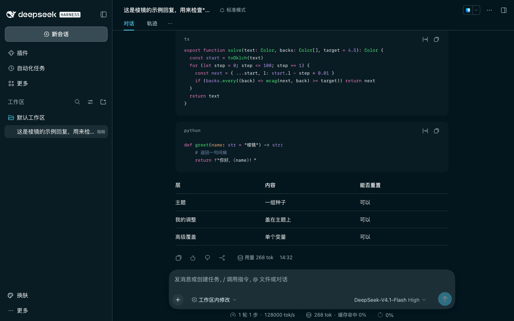
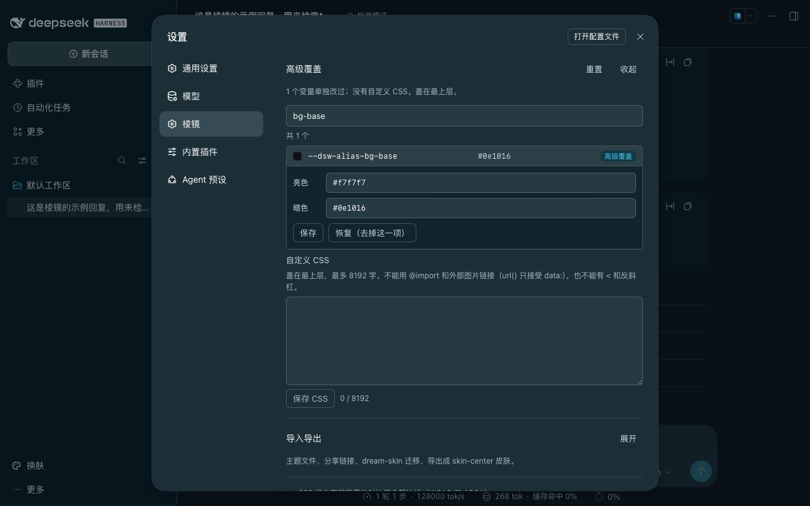
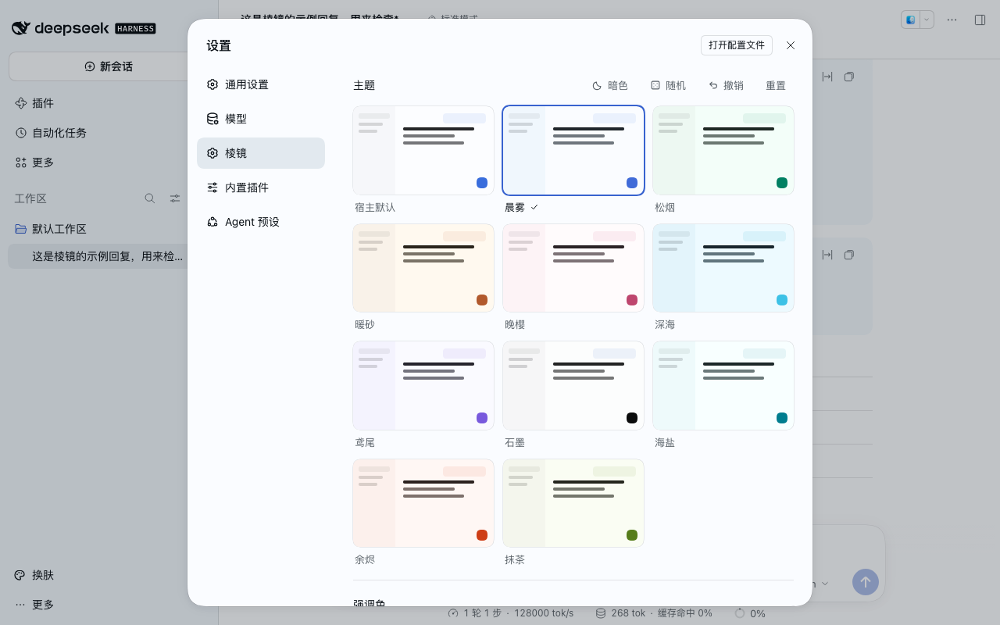
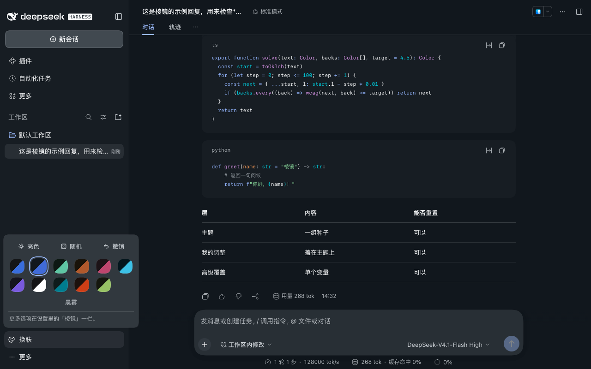

# Prism · dsh-prism-skin

[中文](README.md) | English

A theme plugin for DeepSeek Harness (DSH). A handful of seeds (hue, chroma, neutral tint, contrast, depth, accent) generate the whole palette, in matched light and dark pairs, with text contrast kept legible automatically. Works on both the web build and the desktop app.



| Sand · dark | Abyss · dark |
|---|---|
|  |  |

| Image wallpaper · dark | Gradient wallpaper · light |
|---|---|
|  |  |

| Code colors: Dracula · dark | Advanced: variable search |
|---|---|
|  |  |

| Settings → Prism | Sidebar quick panel |
|---|---|
|  |  |

Light and dark screenshots of all ten themes are in [docs/screenshots/](docs/screenshots/). They were recorded in a throwaway environment with a sample conversation; the interface language in them is Chinese.

## Highlights

- **Recomputes everything.** A theme covers all 224 of the host's color variables, including 8 markdown, 8 diff and 11 syntax-highlighting variables, in both modes. Changing the accent recomputes buttons, links, bubbles, selection states and syntax colors.
- **Always legible.** Each theme is checked against 258 text/background pairs under both WCAG and APCA; when a pair falls short, only lightness moves until it passes. Text on hover states is held to 4.5:1 as well.
- **No flash on load.** The saved palette is in place before the first paint, so the page never flashes the default white or black first. Settings survive server restarts and port changes.
- **Light.** About 20 KB loads at startup; the color engine and settings UI (about 91 KB) load the first time you open the settings page or the quick panel; wallpaper processing (about 5 KB) and the advanced / import-export panels (about 32 KB) only when needed. No live blur, no page-wide DOM observers.
- **Wallpapers and glass.** Images (file, drag and drop, pasted link), gradients, solid colors, link rotation and folder rotation, with one Glass slider for every surface. Images are blurred once, with no live `backdrop-filter`. Text contrast is computed against the darkest and lightest parts of the wallpaper, and transparency drops automatically if needed. One click derives a theme from the wallpaper.
- **Power saving.** Follow system / on / off. With Reduce Transparency, or below 20% battery while unplugged, glass turns off and surfaces become solid colors taken from the wallpaper. The settings page says whether power saving is on and why.
- **Deep customization.**
  - Fonts and sizes: the same settings as General → Fonts.
  - Code colors: GitHub, One, Solarized, Dracula, Monokai or Nord, chosen independently of the theme and still contrast-checked.
  - A corner-radius multiplier.
  - Search any host variable by name and edit it, with its current value and the layer it comes from.
  - Custom CSS: size-capped, no `@import`, no external `url()`.
- **Import & export.**
  - A theme file is a tiny seed JSON.
  - Share codes are short enough to put in a link.
  - One-click migration from dream-skin, plus dream-skin pack import.
  - Export as a Skin Center skin (zip download).
- **Undoable.** Theme → my adjustments → advanced overrides, each layer resettable on its own, every step undoable. Hover to preview, click to apply.

## Install

Requires DSH 0.2.1-rc.5 or later, below 0.3. Tested on 0.2.1-rc.5 (web) and 0.2.2-rc.1 (web and the macOS desktop app).

Install from GitHub Releases (not published to npm yet):

```bash
dsh plugin --profile <name> add https://github.com/Wildchiken/dsh-prism-skin/releases/latest/download/dsh-prism-skin.tgz
```

This link always points to the latest release. To pin a version, use `https://github.com/Wildchiken/dsh-prism-skin/releases/download/v<version>/dsh-prism-skin-<version>.tgz` with a version from [Releases](https://github.com/Wildchiken/dsh-prism-skin/releases).

**macOS desktop app:** quit DeepSeek Harness completely with ⌘Q, install into the `desktop` profile with the app's bundled CLI, then reopen the app:

```bash
cd ~ && "/Applications/DeepSeek Harness.app/Contents/Resources/runtime/cli/bin/dsh" plugin --profile desktop add https://github.com/Wildchiken/dsh-prism-skin/releases/latest/download/dsh-prism-skin.tgz
```

## Use

- **Themes** at the bottom of the sidebar: switch theme, toggle light/dark, randomize, undo.
- **Settings → Prism**: theme gallery, accent, background and glass, power saving, fonts, code colors, tuning sliders and radius, advanced overrides (variables and custom CSS), import & export, contrast check result.
- Picking **Host default** with no wallpaper steps Prism aside completely and restores the host's own palette.

Settings live in `$DSH_HOME/dsh-prism-skin/state.json` (by default `~/.dsh/dsh-prism-skin/state.json`, mode 0600), and wallpapers in `wallpapers/` next to it. Browser localStorage is only a cache; open tabs stay in sync.

## Living with Skin Center and Claude Style

Prism uses no `!important` and no hashed host class names. It changes color variables only through the host's official theme API (`overrideTokens`).

Skin Center and Claude Style override those variables with their own stylesheets. When either is active, Prism shows a notice on its settings page and quick panel instead of fighting them. To see Prism's palette in full, switch Skin Center back to its official default, or disable Claude Style.

Prism can export the current palette as a Skin Center skin, to use inside Skin Center.

## Known limitations

- **About 30% of corners cannot be changed.** About 70% of the host's corners use the `--dsw-radius-*` variables and follow the radius slider. The rest (mostly 1–4px details) are hard-coded in the host's styles. Prism does not patch them through hashed class names.
- **Use share codes between desktop apps.** A share link carries the current address, and the desktop app picks a new port on every launch, so a link will not open on another computer. Copy the share code and paste it into the other side's Import box.
- **Font changes are not undoable.** Fonts and sizes write the host's General settings, outside Prism's undo history. Fonts carried by an imported theme file cannot be undone either; the import preview says so.
- **Not yet tested on the desktop app:** GPU usage in a real window, automatic power saving on low battery (the battery API was only tested with a simulated battery), and the system file picker when choosing a local wallpaper image.
- **The quick panel cannot jump to the settings page.** The host offers sidebar plugins no way to open Settings at a given section, so the panel footer is a plain note rather than a link.
- **dream-skin migration is not pixel-identical.** A theme is converted into a seed from its canvas, accent and mode, and every other color is recomputed with contrast guaranteed. Bright dark backgrounds (such as Nord) come out a little darker, because dark surfaces have a lightness cap that keeps white text at 7:1.
- **The wallpaper folder is never cleaned up.** Replaced images stay in `wallpapers/`.
- Safari and Firefox have no Battery Status API, so there "follow system" only looks at Reduce Transparency.

## Develop

```bash
npm install
npm test                 # unit tests, including the size gates and the contrast audit
npm run build            # output in lib/
npm run audit:contrast   # per-theme and per-code-scheme contrast report
```

Smoke tests and screenshots against a real host need a local host install (`npm install @deepseek-ai/dsh@<version>`):

```bash
node scripts/smoke.mjs --host <host dir> [--host <another version>]
node scripts/shots.mjs --host <host dir> --extras --wallpapers --p3
```

Both scripts use `~/.dsh-prism-*` as a throwaway `DSH_HOME`, delete it afterwards, and never touch your own `~/.dsh`.

Changes are listed in [CHANGELOG.md](CHANGELOG.md).

## Credits

The palette approach draws on dsh-dream-skin; see [NOTICE](NOTICE).

## License

[MIT](LICENSE)
