<p align="center">
  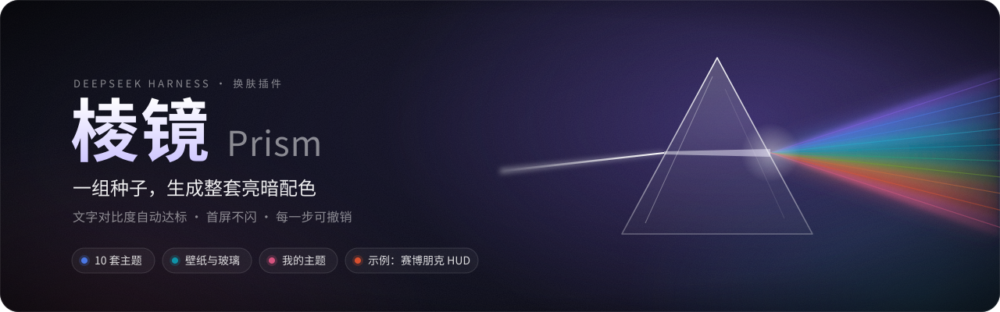
</p>

<p align="center">
  <a href="https://github.com/Wildchiken/dsh-prism-skin/releases/latest"></a>
  
  
  <a href="LICENSE"></a>
</p>

<p align="center"><b>中文</b> · <a href="README.en.md">English</a></p>

给 DeepSeek Harness（DSH）换肤。挑一套主题，或者拖几个滑杆（色相、彩度、中性色调、对比度、明暗、强调色），棱镜就把宿主全部颜色变量重算一遍，亮色暗色成对出现，每一组文字都检查过对比度。

<p align="center">
  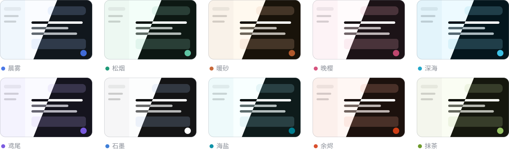
</p>
<p align="center"><sub>十套内置主题：每张卡左上半是亮色、右下半是暗色。图里的颜色由配色引擎现算，不是截图。</sub></p>

## 示例：Material 3

照安卓 16 的 Material 3（Material You）做的一套主题，同样是一个主题文件：

<p align="center">
  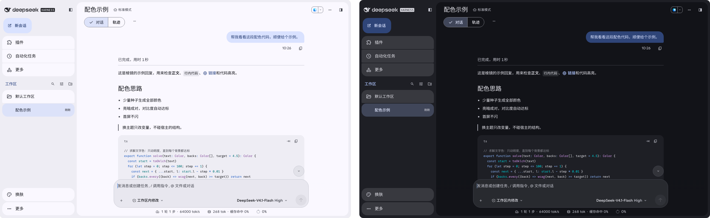
</p>

- **颜色跟着强调色变**：主题里写的不是颜色，而是「宿主变量 → Material 配色角色」。棱镜用 Google 开源的 material-color-utilities 按当前强调色现算整套配色（Tonal Spot，安卓默认的方案），亮暗成对。侧栏面板里点一下就换：

  <p align="center">
    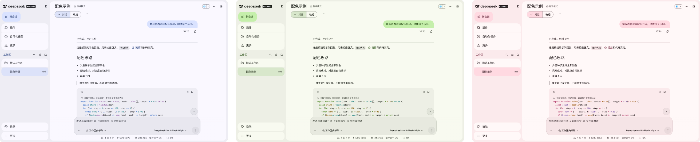
  </p>

- **照官方开源实现**：组件尺寸、圆角层级、状态层、弹簧动效取自 material-web 的设计变量；侧栏和设置页的分段列表、开关照安卓 16 设置页（AOSP SettingsLib）。没有阴影，层次只靠底色深浅。
- **图标、水波纹、字体**：宿主的图标全部换成 Material Symbols（圆角）；按下时水波纹从按下的地方扩散。本机装了 Google Sans Flex、Google Sans Code 就用它们，没装就用系统字体。
- **怎么装**：需要棱镜 0.7.0 及以上。下载 [`material-3.json`](https://github.com/Wildchiken/dsh-prism-skin/releases/latest/download/material-3.json)，在 **设置 → 棱镜 → 导入导出** 里导入并应用。

> [!NOTE]
> 和下面的赛博朋克 HUD 一样，组件样式靠自定义 CSS 匹配宿主内部的类名，DSH 升级后可能有部分失效（配色不受影响）。`node scripts/audit-theme.mjs` 能逐个画面检查（见下面「开发」）。这套主题不是 Google 出品；Material Design 和 Material Symbols 是 Google 的开源设计系统（Apache-2.0）。

## 示例：赛博朋克 HUD

主题文件不只能带配色，还能带变量覆盖和自定义 CSS。下面这套「赛博朋克 HUD」就是一个主题文件，导入即用：

<p align="center">
  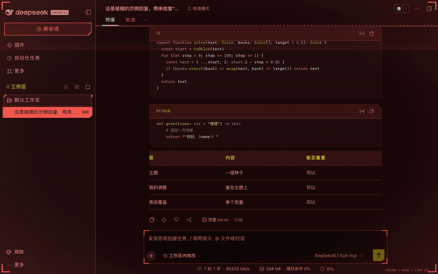
</p>

- **样子**：红黑底色，青色标题，黄色强调；侧栏、按钮、代码块、消息改成切角框体，窗口四角带括号，一层很淡的扫描线。
- **动起来**：扫描线慢慢往下走，悬停时有轻微的故障抖动，选中时闪一下。系统打开「减少动态效果」或棱镜在省电时，全部停下。
- **怎么装**：下载 [`cyberpunk-hud.json`](https://github.com/Wildchiken/dsh-prism-skin/releases/latest/download/cyberpunk-hud.json)，在 **设置 → 棱镜 → 导入导出** 里点「选择文件…」，再点「应用」。它会带着名字进「我的主题」，以后一点就回来。

> [!NOTE]
> 这套主题的框体靠自定义 CSS 匹配宿主内部的类名，DSH 升级后可能有部分框体失效（配色不受影响），届时更新这个文件即可；`node scripts/check-theme.mjs` 能检查新版宿主上哪些还能匹配。只有暗色版本。风格致敬赛博朋克题材，和任何游戏或公司无关。

## 安装

需要 DSH 0.2.1-rc.5 及以上、0.3 以下。已在 0.2.1-rc.5（网页版）和 0.2.2-rc.1（网页版、macOS 桌面版）上实测。

**命令行 / 网页版**

```bash
dsh plugin --profile <名字> add https://github.com/Wildchiken/dsh-prism-skin/releases/latest/download/dsh-prism-skin.tgz
```

**macOS 桌面版**：先用 ⌘Q 完全退出 DeepSeek Harness，用桌面版自带的命令行装到 `desktop` 配置，装完重新打开。

```bash
cd ~ && "/Applications/DeepSeek Harness.app/Contents/Resources/runtime/cli/bin/dsh" plugin --profile desktop add https://github.com/Wildchiken/dsh-prism-skin/releases/latest/download/dsh-prism-skin.tgz
```

上面的链接总是指向最新版，适合第一次安装。目前还没有发布到 npm。

**升级**：用带版本号的链接再装一次，把 `<版本>` 换成 [Releases](https://github.com/Wildchiken/dsh-prism-skin/releases) 里的新版本号（如 `0.6.0`）。桌面版同样先退出、用桌面版自带的命令行。

```bash
dsh plugin --profile <名字> add https://github.com/Wildchiken/dsh-prism-skin/releases/download/v<版本>/dsh-prism-skin-<版本>.tgz
```

不要重复运行 latest 链接来升级：地址没变，pnpm 会以为已经是最新版，不会重新下载。

## 怎么用

- **侧栏底部「换肤」**：换主题、切明暗、随机一套、撤销。面板上显示当前主题名，改过会标「已修改」。
- **设置 → 棱镜**：最上面一行是当前主题，带三个按钮——「丢弃修改」「存为我的主题」「恢复默认」。下面依次是主题画廊、强调色、背景与玻璃、省电、字体、代码配色、微调和圆角、高级覆盖、导入导出、对比度检查结果。

一套主题和你在上面做的修改是分开的两层：

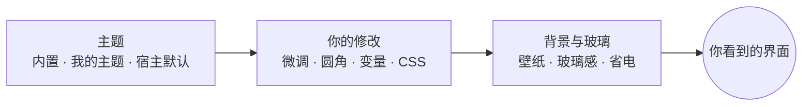

- **换主题就是整套换**：选哪张卡就是哪套的原样，之前的修改一起清掉（对比度和明暗两项个人偏好保留）。
- **修改想留下**：点「存为我的主题」，起个名字，连同修改存成一套。「我的主题」最多 24 个，可以改名；卡片悬停时右上角可以删除（要点两次），删了几秒内能撤销。
- **想全部回到原样**：点「恢复默认」，主题、修改、背景一起清掉。
- **每一步都能撤销**，点击才生效；悬停只显示名字，不会把整个界面换来换去。

## 能做什么

**配色**
- 一套主题覆盖宿主全部 224 个颜色变量（含 markdown、diff、代码高亮），亮暗各一份。换强调色时，按钮、链接、气泡、选中态、代码高亮全部跟着重算。
- 每套主题逐对检查 258 组文字和背景，WCAG 和 APCA 两个标准都要过，不够就只调明度直到达标。悬停时的文字也按 4.5:1。
- 代码配色可以单独选 GitHub、One、Solarized、Dracula、Monokai、Nord，对比度照样自动达标。

**背景**
- 图片（选文件、拖进来、粘贴链接）、渐变、纯色、链接轮播、文件夹轮播；一根「玻璃感」滑杆管所有表面。
- 图片只模糊一次，不开实时 `backdrop-filter`。文字对比度按壁纸上最暗和最亮的地方算，不够就自动降低透明度。一键从壁纸取色。
- 省电模式：跟随系统 / 开 / 关。系统开「减少透明度」，或电量低于 20% 且没在充电时自动省电，表面换成按壁纸算出的纯色。

**自定义**
- 字体和字号（和「通用 → 字体」是同一份设置）、圆角倍数。
- 按名字搜宿主全部变量直接改，能看到当前值和来自哪一层。
- 自定义 CSS：最多 16384 字符，禁止 `@import` 和外部链接的 `url()`。省电时 `body` 上会有 `data-prism-saving` 属性，写动画的主题可以用 `:not([data-prism-saving])` 在省电时停下。元素上写 `--prism-ripple: 1` 的，按下时棱镜会写上 `--prism-x` / `--prism-y`（按下点的位置），水波纹可以从按下的地方扩散。

**导入导出**
- 主题文件是一小段 JSON：配色种子，可以带变量覆盖、自定义 CSS、圆角和 Material 动态取色规则（按强调色现算整套 Material 3 配色）。导入后进「我的主题」。
- 分享码很短，也能放进链接。
- 一键从 dream-skin 迁移，兼容导入 dream-skin 主题包；可以导出成 skin-center 皮肤（zip）。

**轻和快**
- 首屏不闪：保存的配色在页面第一次绘制之前就生效。
- 开机只加载约 21 KB 的入口；配色引擎和设置界面约 97 KB，第一次打开设置页或快捷面板时才加载；壁纸处理约 5 KB、高级和导入导出约 32 KB，用到才加载。不开实时模糊，不挂整页的 DOM 监听。

<details>
<summary><b>更多截图</b></summary>

| 设置 → 棱镜 | 侧栏快捷面板 |
|---|---|
| 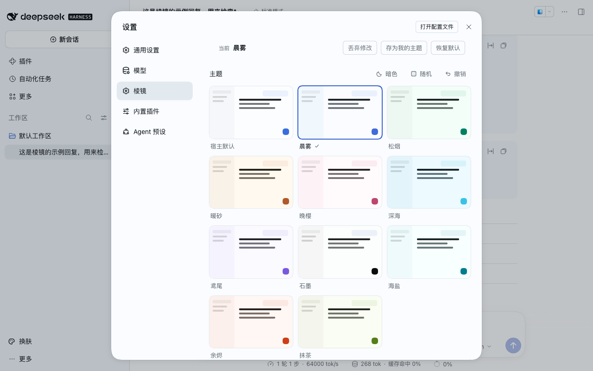 | 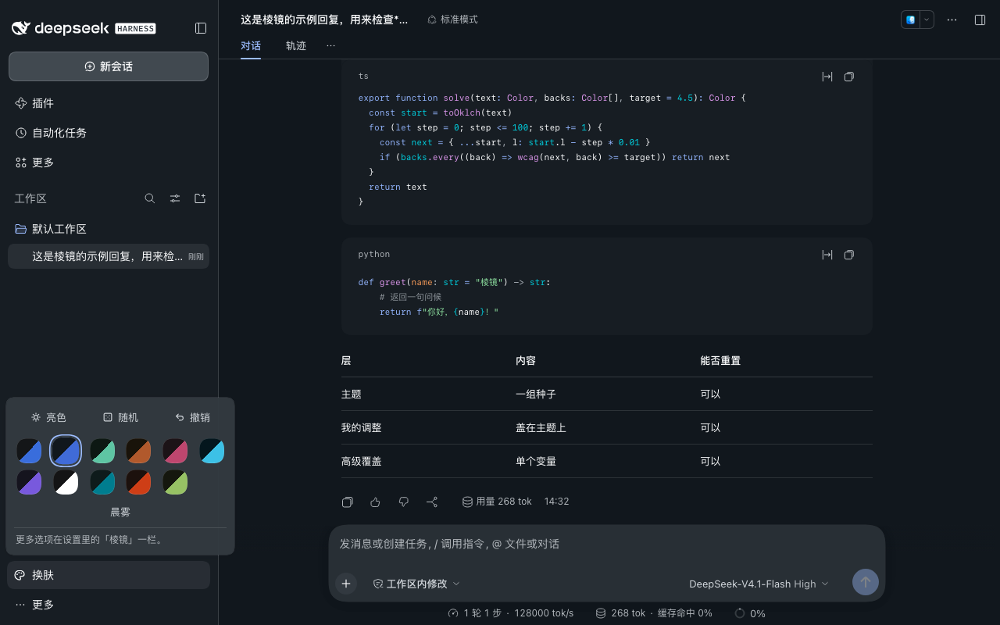 |

| 图片壁纸 · 暗色 | 渐变壁纸 · 亮色 |
|---|---|
| 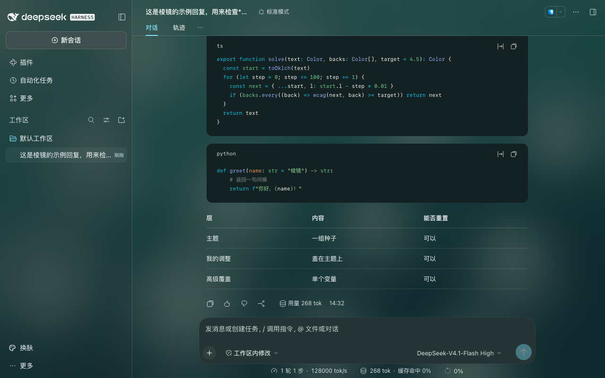 | 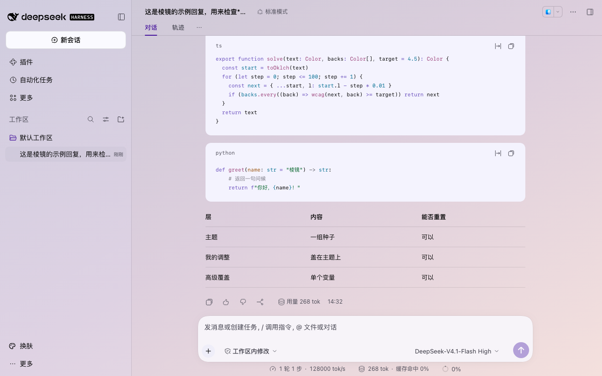 |

| 代码配色 Dracula · 暗色 | 高级：变量搜索编辑 |
|---|---|
| 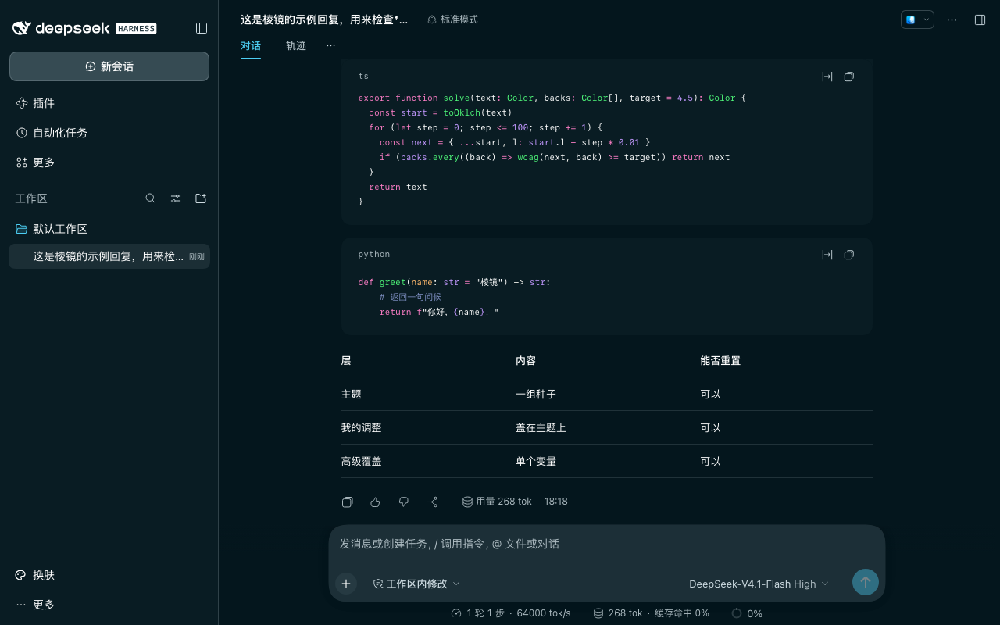 | 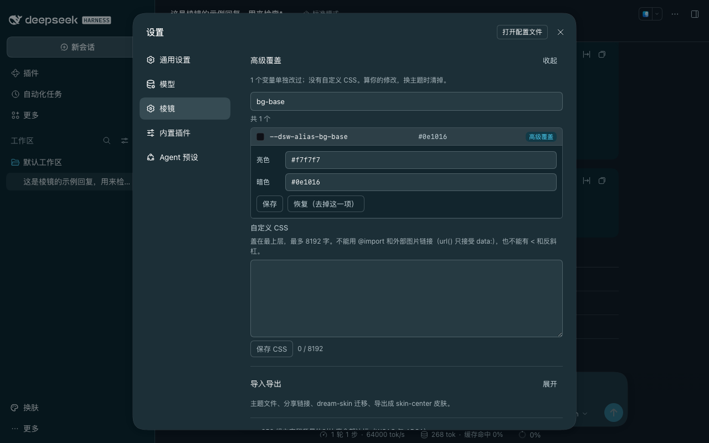 |

十套主题的亮暗截图都在 [docs/screenshots/](docs/screenshots/)。截图都在临时环境里录制，用的是示例会话。

</details>

## 和其他换肤插件一起用

棱镜本身不用 `!important`，也不依赖宿主的哈希类名，只通过宿主正式的主题接口（`overrideTokens`）改颜色变量。（你自己写的或主题文件带的自定义 CSS 例外，比如上面的赛博朋克 HUD。）

别的换肤插件如果用自己的样式盖住这些变量，棱镜的配色就会显示不全，建议同一时间只开一个换肤插件。棱镜能认出几个常见的（目前是 skin-center 和 claude-style），检测到时只在设置页和快捷面板上提示，不去抢。

设置保存在 `$DSH_HOME/dsh-prism-skin/state.json`（默认 `~/.dsh/dsh-prism-skin/state.json`，权限 0600），壁纸存在同目录的 `wallpapers/` 里。浏览器的 localStorage 只做缓存，多个标签页之间实时同步。

<details>
<summary><b>已知限制</b></summary>

- **圆角约三成改不到**：宿主约七成的圆角走 `--dsw-radius-*` 变量，会跟着「圆角」滑块变；其余约三成（多是 1–4px 的细节）写死在宿主样式里。棱镜不靠宿主的哈希类名去补。
- **桌面版之间分享用分享码**：分享链接里带的是当前地址，桌面版每次启动端口都不一样，所以链接在别的电脑上打不开。请复制分享码，在对方的「导入」框里粘贴。
- **字体改动不进撤销**：字体和字号写的是宿主「通用」里的设置，不在棱镜的撤销历史里；导入主题文件时带的字体也不能撤销（导入前的预览会写明）。
- **还没在桌面版上实测的**：真实窗口下的 GPU 占用、低电量自动省电（电池状态接口只在模拟电池上测过）、选本地图片作壁纸时的系统选择框。
- **快捷面板跳不到设置页**：宿主目前没有让侧栏插件「打开设置并定位到某一栏」的接口，所以面板底部只写了一句说明。
- **dream-skin 迁移不会一模一样**：主题按底色、强调色、明暗换算成种子，其余颜色重算并保证对比度。偏亮的暗色底（如 Nord）会更深一点。
- **壁纸目录不会自动清理**：换下来的图片会一直留在 `wallpapers/` 里。
- Safari 和 Firefox 没有电池状态接口，在这两个浏览器里「跟随系统」只看「减少透明度」。

</details>

<details>
<summary><b>开发</b></summary>

```bash
npm install
npm test                       # 单测，含体积门和对比度审计
npm run build                  # 产物在 lib/
npm run audit:contrast         # 逐套主题、逐套代码配色打印对比度审计
node scripts/readme-art.mjs    # 重画 README 的横幅和主题一览图
node scripts/check-theme.mjs --host <宿主目录> --theme themes/cyberpunk-hud.json   # 主题框体在这个宿主版本上还能不能匹配
node scripts/audit-theme.mjs --host <宿主目录> --theme themes/material-3.json --radii 0,4,8,12,16,20,28 --icons   # 主题体检：逐个画面比有无主题、查对比度和悬停，默认中文界面（--locale en-US 看英文），结果在 .cache/audit
node themes/src/fetch-symbols.mjs && node themes/src/material-3.mjs   # 重新生成 Material 3 示例主题（先取图标）
node themes/src/cyberpunk-hud.mjs   # 重新生成赛博朋克 HUD 示例主题
```

真宿主上的冒烟和截图需要一份本地安装的宿主（`npm install @deepseek-ai/dsh@<版本>`）：

```bash
node scripts/smoke.mjs --host <宿主目录> [--host <另一个版本>]
node scripts/shots.mjs --host <宿主目录> --extras --wallpapers --p3
```

两个脚本都用 `~/.dsh-prism-*` 作临时 `DSH_HOME`，用完删掉，不碰你自己的 `~/.dsh`。改动记录见 [CHANGELOG.md](CHANGELOG.md)。

</details>

## 致谢与许可

配色思路参考 dsh-dream-skin，见 [NOTICE](NOTICE)。以 [MIT](LICENSE) 许可发布。
